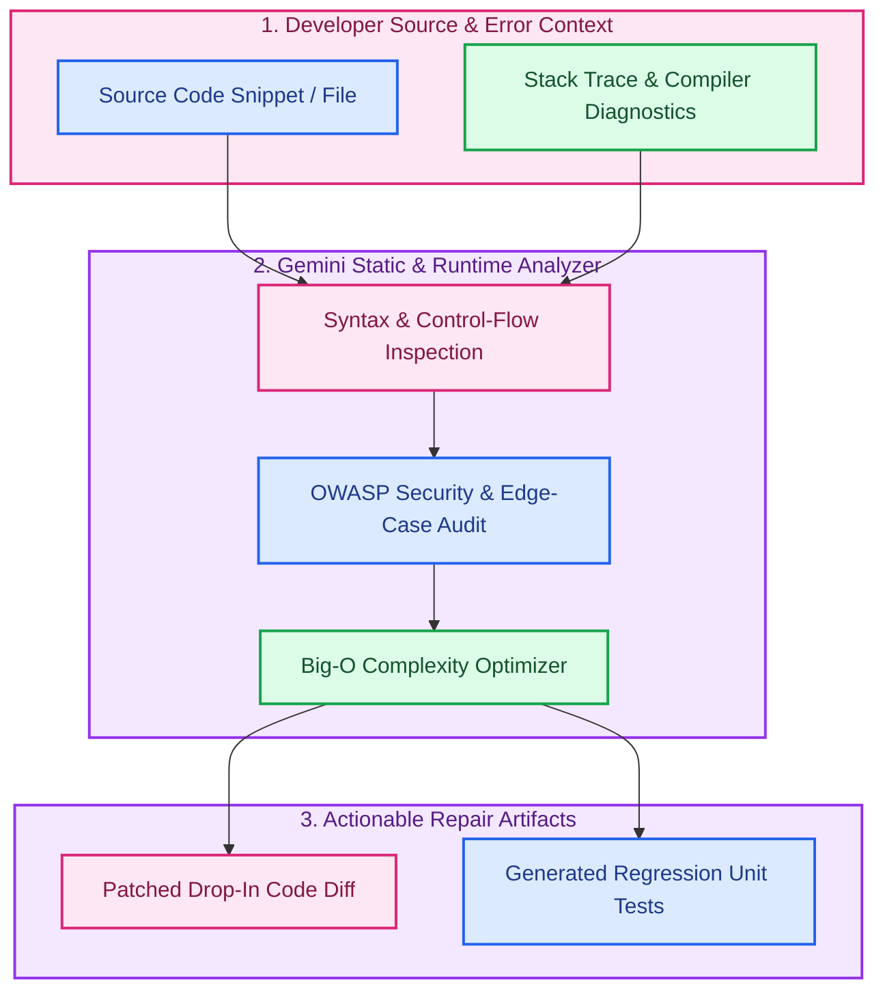

# 🚀 AI Code Debugger Pro – AI-Powered Code Analysis & Generation  


> **Author & Architect:** [Robina Mirbahar](https://github.com/RobinaMirbahar) ([Google Developer Expert in Cloud & AI](https://developers.google.com/profile/u/106918534005910641104?utm_campaign=deveco_gdemembers&utm_source=deveco) · Google Cloud Champion Innovator · Co-Author of [*AI Engineering*](https://www.amazon.com/dp/B0GWCZWCF4))  
> **Focus:** Automated Static Analysis, Bug Root-Cause Detection, Complexity Optimization & Unit Test Generation with Google Gemini

---

## 🎯 Why I Built AI Code Debugger Pro (Engineering Purpose & Real-World Value)

### 1. 🐞 Eliminating Manual Stack-Trace Hunting
I built AI Code Debugger Pro to turn cryptic compiler errors, race conditions, and runtime stack traces into structured root-cause explanations with drop-in patched code.

### 2. ⚡ Time & Space Complexity Refactoring
Beyond fixing syntax bugs, I designed the analyzer to detect $O(n^2)$ bottlenecks, memory leaks, and anti-patterns, rewriting them into idiomatic, high-performance implementations.

### 3. 🔒 Built-In Security & Unit Test Synthesis
Every debugging pass automatically checks for injection flaws and generates edge-case unit tests so fixed bugs never regress.

---

## 🏗️ System Architecture



---

**AI Code Debugger Pro** is an AI-powered tool designed to assist developers in **debugging, optimizing, and generating** code with **Google Gemini 2.0 Pro**. Whether you need to fix errors, improve performance, or generate code snippets, this interactive tool streamlines the process in a user-friendly interface.  

🔗 **Live Demo:** [AI Code Debugger Pro](https://ai-code-debuggeer.streamlit.app//)  

## ✨ Key Features  

### 📤 **Code Upload & Manual Input**  
✔️ Upload files **(.py, .js, .java, .cpp, etc.)** or paste code for analysis.  
✔️ Supports multiple programming languages with **auto-detection**.  

### 🔍 **AI-Powered Code Analysis** (Using Gemini 2.0 Pro)  
✔️ **Detects syntax, logic, and performance issues.**  
✔️ Provides:  
   ✅ **Corrected Code** (with line numbers & highlights).  
   ✅ **Error Explanation** (detailed breakdown).  
   ✅ **Optimization Suggestions** (best practices & security tips).  

### 🤖 **AI Agent for Follow-Up Questions**  
✔️ Ask follow-up questions about the analyzed code.  
✔️ Get **context-aware answers** based on the code and analysis results.  
✔️ Example questions:  
   - "Can you explain the security issue on line 12?"  
   - "How can I optimize this code further?"  
   - "What does the complexity 'medium' mean in this context?"  

### 💡 **AI Code Generation** (Powered by Gemini 2.0 Pro)  
✔️ Enter a **natural language prompt**, and AI will generate fully functional, optimized code.  
✔️ Ensures **syntax correctness, efficiency, and clarity**.  

### 📊 **Side-by-Side Comparisons**  
✔️ View **original & corrected code** in an interactive UI.  
✔️ **Structured explanations** of errors and fixes.  

### ⚡ **Instant Feedback & History Tracking**  
✔️ Stores analysis & generation results **within the session**.  
✔️ Displays **execution time** for performance tracking.  

### 🔐 **Secure Processing**  
✔️ **Powered by Google Gemini 2.0 Pro** for **high-quality AI-driven analysis**.  
✔️ **No code storage beyond the session** for **security & privacy**.  

## � **Model Used: Google Gemini 2.0 Pro**  

🔹 **Why Gemini 2.0 Pro?**  
✅ **Advanced NLP** – Handles complex coding queries.  
✅ **Contextual Understanding** – Provides in-depth debugging & categorization.  
✅ **Optimized for Code Generation** – Produces structured, efficient, and secure code.  

## 🎯 **Use Cases**  

👩‍💻 **Students & Learners** – Quickly debug and understand errors.  
🛠️ **Developers & Engineers** – Improve efficiency and follow best practices.  
🔍 **Security Analysts** – Identify vulnerabilities in the code.  
📊 **Tech Leads & Reviewers** – Automate parts of the review process.  

## 🎬 **Demo Walkthrough**  

🔹 **Step 1:** Paste or Upload Code → Select language & analysis type → Click **Analyze Code**  

🔹 **Step 2:** AI Debugging & Recommendations → View **Corrected Code, Explanation & Optimizations**  

🔹 **Step 3:** AI Code Generation → Enter a description → Click **Generate Code**  

🔹 **Step 4:** Ask Follow-Up Questions → Get **context-aware answers** from the AI agent.  

## 🔄 **Workflow**  

1. **Input Code**:  
   - Upload a code file or paste code directly into the text area.  
   - Select the programming language or use **Auto-Detect**.  

2. **Analyze Code**:  
   - Click **Analyze Code** to start the AI-powered analysis.  
   - The app detects **syntax errors, logical errors, and security issues**.  

3. **View Results**:  
   - See the **corrected code** with line numbers and highlights.  
   - Read detailed explanations of errors and fixes.  
   - Get **optimization suggestions** and **security tips**.  

4. **Ask Follow-Up Questions**:  
   - Use the AI agent to ask questions about the analyzed code.  
   - Get **context-aware answers** based on the code and analysis results.  

5. **Generate Code**:  
   - Enter a natural language prompt to generate new code.  
   - The AI generates **fully functional, optimized code** based on your description.  

6. **Compare & Optimize**:  
   - View **side-by-side comparisons** of the original and corrected code.  
   - Apply **optimizations** and **security fixes** suggested by the AI.  

## 🚀 **Get Started**  

### 1️⃣ **Installation**  
Ensure you have **Python 3.8+** installed, then run:  

```bash
pip install streamlit google-generativeai pygments
```
### 2️⃣ ** Run the App** 
```bash
streamlit run AIdebugger.py
```
### 🌟 Contribute & Support ### 
🛠️ Want to improve AI Code Debugger Pro? Contributions are welcome! Fork the repo and submit a PR.

## 🔥 **Conclusion**  

AI Code Debugger Pro, powered by **Google Gemini 2.0 Pro**, is a **game-changer for developers** – offering **instant debugging, deep analysis, AI-generated solutions, and follow-up support** to **save time and improve code quality.** 🚀  

🔗 **Try it now:** [AI Code Debugger Pro](https://ai-code-debugger.streamlit.app/)
---

### Official Google Developer Resources
- [Google Gemini API & AI Studio Docs](https://ai.google.dev/gemini-api/docs?utm_campaign=deveco_gdemembers&utm_source=deveco)
